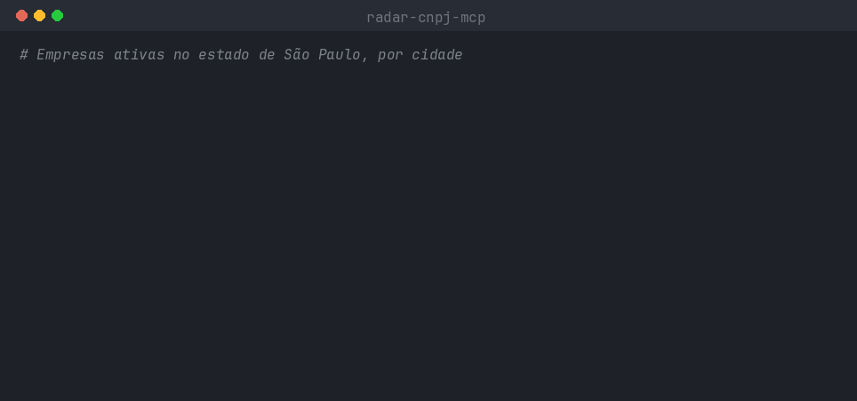

<div align="center">

# 📡 radar-cnpj-mcp

**Encontre empresas por atividade e região na base pública de CNPJ da Receita Federal,
direto do seu agente de IA ou do terminal.**

[](https://github.com/wendersoon/radar-cnpj-mcp/actions/workflows/ci.yml)
[](https://modelcontextprotocol.io)
[](https://nodejs.org)
[](LICENSE)


</div>

## Por que

Você vende algo para empresas e quer saber **quem são os clientes possíveis na sua região**:
quantas oficinas existem em Campinas, quais academias abriram este ano em São Paulo, onde
se concentram as clínicas odontológicas do estado.

A Receita Federal publica o cadastro de **mais de 70 milhões de estabelecimentos**, mas em
arquivos brutos de vários GB. O radar-cnpj-mcp transforma isso numa base local, consultada
em milissegundos, que o seu agente de IA entende.

- ⚡ **Instantâneo**: buscas em milissegundos, mesmo no Brasil inteiro
- 🔒 **Local e gratuito**: os dados ficam na sua máquina, sem mensalidade nem limite de resultados
- 🧠 **Feito para IA**: o agente traduz "oficina mecânica" para o CNAE certo e aplica os filtros
- 🇧🇷 **Pensado para o Brasil**: busca sem acentos, MEI separado de microempresa, CSV pronto para o Excel

## Pergunte do seu jeito

> **Você:** Quantas oficinas mecânicas ativas existem em Campinas?
>
> **Claude:** 2.301 estabelecimentos com a atividade principal 4520-0/01 (manutenção e
> reparação mecânica de veículos). Desses, 1.407 são MEIs e 783 são microempresas.

Outras ideias:

- _"Liste academias abertas desde 2025 em Santo André, sem MEI, com telefone."_
- _"Em quais cidades de SP há mais clínicas odontológicas?"_
- _"Exporte para CSV os restaurantes do bairro Pinheiros."_

## Como usar

Requer [Node.js](https://nodejs.org) 20 ou superior.

**1. Baixe a base das UFs que interessam.** Só as UFs pedidas, em segundos, a partir da base
pronta do [radar-cnpj-dados](https://github.com/wendersoon/radar-cnpj-dados):

```sh
npx -y radar-cnpj-mcp baixar --ufs SP,MG
```

**2. Conecte ao seu agente de IA.**

<details open>
<summary><b>Claude Code</b></summary>

```sh
claude mcp add radar-cnpj -- npx -y radar-cnpj-mcp
```

</details>

<details>
<summary><b>Claude Desktop, Cursor, VS Code e outros</b></summary>

```json
{
  "mcpServers": {
    "radar-cnpj": {
      "command": "npx",
      "args": ["-y", "radar-cnpj-mcp"]
    }
  }
}
```

</details>

Pronto: peça ao agente o que procura. Para atualizar a base todo mês, rode o `baixar` de novo.

### Instalação via npm

Se preferir instalar em vez de usar o `npx`:

```sh
npm install -g radar-cnpj-mcp
radar-cnpj-mcp baixar --ufs SP,MG
```

E configure o agente com o comando instalado:

```sh
claude mcp add radar-cnpj -- radar-cnpj-mcp
```

```json
{
  "mcpServers": {
    "radar-cnpj": { "command": "radar-cnpj-mcp" }
  }
}
```

Para atualizar a ferramenta: `npm update -g radar-cnpj-mcp`.

<details>
<summary><b>Importar direto da Receita Federal</b></summary>

Para usar um mês que ainda não está no radar-cnpj-dados, baixe a pasta do mês em
[arquivos.receitafederal.gov.br](https://arquivos.receitafederal.gov.br/) (**Dados › Cadastros ›
CNPJ**, cerca de 7 GB) e importe:

```sh
npx -y radar-cnpj-mcp importar ~/Downloads/2026-10 --ufs SP,MG
```

A importação lê todos os arquivos da Receita, então leva alguns minutos mesmo para uma só UF.

</details>

## O que o agente ganha

| Ferramenta         | O que faz                                                                    |
| ------------------ | ---------------------------------------------------------------------------- |
| `buscar_empresas`  | Lista empresas com CNPJ, razão social, atividade, endereço e contatos        |
| `contar_empresas`  | Conta empresas, agrupando por UF, município, bairro, CNAE, porte, MEI ou ano |
| `buscar_cnae`      | Descobre o código CNAE a partir da descrição da atividade                    |
| `buscar_municipio` | Encontra municípios pelo nome                                                |
| `detalhar_empresa` | Mostra todos os dados de um CNPJ                                             |
| `exportar_csv`     | Gera uma planilha CSV pronta para o Excel                                    |
| `status_base`      | Informa o mês de referência e as UFs importadas                              |

**Filtros:** CNAE (exato ou por prefixo, principal ou secundário), UF, município, bairro,
CEP, situação cadastral, data de abertura, porte, MEI, matriz/filial, capital social e
existência de telefone ou e-mail.

**Atalhos (prompts):** `consultar_empresas`, `panorama_setor` e `empresas_recentes`. No Claude
Code, viram comandos como `/radar-cnpj:consultar_empresas`.

**Resources:** `radar://status`, `radar://cnaes`, `radar://municipios/{uf}` e
`radar://empresa/{cnpj}`, para anexar à conversa.

## No terminal



```sh
npx radar-cnpj-mcp contar --cnae 4520-0/01 --uf SP --agrupar municipio
npx radar-cnpj-mcp buscar --cnae 4520-0/01 --municipio Campinas --sem-mei --limite 20
npx radar-cnpj-mcp buscar --cnae 4520 --municipio Campinas --csv oficinas.csv
npx radar-cnpj-mcp status
npx radar-cnpj-mcp --help
```

## Privacidade

Os dados são públicos e ficam só na sua máquina. Por padrão, **telefone e e-mail de MEIs
ficam ocultos**, porque costumam ser os da própria pessoa física. Ao usar os dados para
contatar empresas, respeite a LGPD: faça ofertas ligadas à atividade delas e ofereça uma forma
de não serem mais contatadas.

## Desenvolvimento

```sh
npm install
npm test           # testes
npm run lint       # Biome
npm run typecheck
npm run build
```

## Contribuindo

Contribuições são bem-vindas! Veja o [CONTRIBUTING.md](CONTRIBUTING.md).

## Licença

[MIT](LICENSE). Dados: [Receita Federal do Brasil – Dados Abertos do
CNPJ](https://arquivos.receitafederal.gov.br/).

## LGPD

O radar-cnpj-mcp foi feito com a LGPD em mente:

- usa a base pública de CNPJ publicada pela Receita Federal e não inclui os dados de sócios;
- remove dos dados os números em formato de CPF;
- mantém ocultos o telefone e o e-mail de MEIs, que não são publicados nos dados prontos.

A razão social de MEIs e empresários individuais pode conter o nome da pessoa, como consta na
base da Receita. Cada usuário é responsável por usar os dados de acordo com a LGPD. Este aviso
não é um parecer jurídico.
